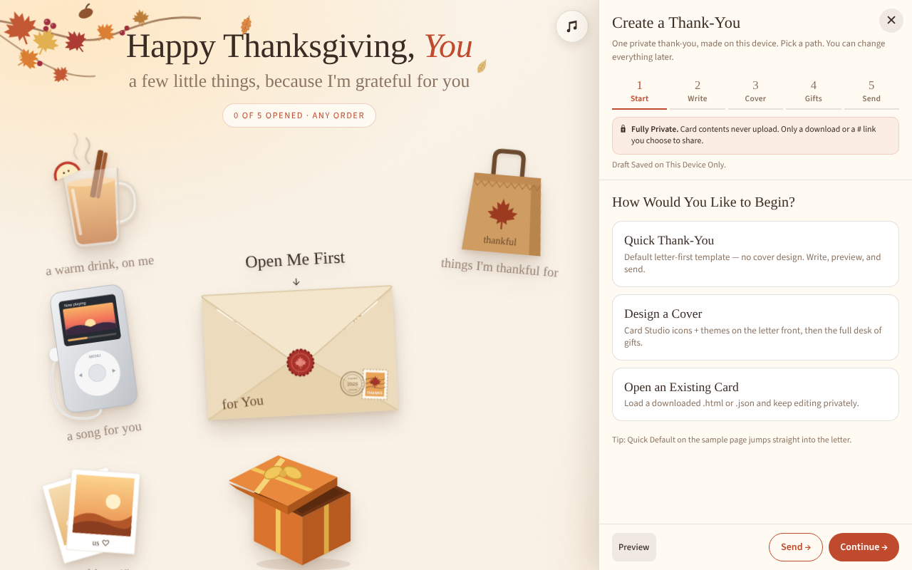

# 🍁 Thanksgiving Thank-You Card

A cozy, interactive thank-you page that looks like a desk of little gifts. The recipient opens the
**Open Me First** letter (with an optional illustrated card cover on the front), then unlocks a cup of cider,
a music player, a gratitude bag, an invitation ticket, photos, a gift card, and a gift box finale.
Autumn leaves drift in the background.

**Private by design.** Your card is made in your browser and never uploaded. Send it as one HTML file or as a
private `#` link.


**[Live Sample →](https://lindenwang1.github.io/Thanksgiving/)** · **[Create Your Own →](https://lindenwang1.github.io/Thanksgiving/create.html)**

## Make a Card

Open `create.html` (or click **Create a Thank-You** on the sample) and follow five steps:

| Step | What You Do |
|---|---|
| **1 · Start** | **Quick Thank-You** (letter only, no cover), **Design a Cover**, or **Open an Existing Card** |
| **2 · Write** | Names, greeting, page theme, and your letter. The desk updates live. |
| **3 · Cover** | Pick a starter cover, then change the title, colors, style, and icons. Skipped on Quick Thank-You. |
| **4 · Gifts** | Turn each gift on or off and fill in its details. Pick what the drink is (cider, iced matcha, coffee, hot cocoa, tea, boba, or your own photo), and give any thankful-list line its own little picture. |
| **5 · Send** | **Download Private Card** or **Copy Private Link** |

Drafts autosave in your browser on this device only. **Preview** hides the editor so you can open the letter the
way the recipient will.

| Address | Opens |
|---|---|
| `index.html` | The public sample |
| `create.html` or `index.html#create` | The create flow, starting at Step 1 |
| `index.html#create=default` | Quick Thank-You: skips the cover, greeting starts as **Happy Thanksgiving, You** |
| `customize.html` | A small menu linking to the three options below |
| `index.html#edit` | The editor on the sample itself |



## Send It Privately

| Option | Best For | How It Works |
|---|---|---|
| **Download Private Card** | Photos (including a drink photo), gift codes, your own music | One self-contained `.html` file. Text, email, or AirDrop it. Opens offline in any browser. |
| **Copy Private Link** | A quick note | The whole card is packed into the link after `#c=…`. Browsers never send that part to the server, so GitHub stores nothing. Uploaded photos can't fit; use `https://` image links instead. |
| **Script** (`tools/make_card.py`) | Making several cards from JSON | See below |

Downloaded and scripted cards are automatically hidden from search engines, open as the card (not the sample),
and don't show the **Create a Thank-You** buttons. To edit one later, use **Open an Existing Card** in Step 1, or
add `#edit` to the end of its address.

### Privacy Notes
- Anyone who has the file or link can see everything in it, including gift-card codes.
- If you host a personal card online, use an unguessable address (for example a Netlify Drop link), not this public repo.
- For music, use a song you have the rights to share, or leave `src` empty to use the built-in tune.

### Script

```bash
mkdir -p private/you/photos
cp people.example.json private/you/you.json   # edit it
# put photos in private/you/photos/
python3 tools/make_card.py private/you/you.json
# → private/you/thanksgiving-you.html  (photos and music embedded)
```

Uses only the Python standard library. `private/` and `thanksgiving-*.html` are in `.gitignore`, so personal
cards are never committed.

## Themes, Covers, and Icons

**8 page themes:** `harvest` (default) · `cranberry` · `sage` · `maple` · `cider` · `mist` (Soft Mist) · `juniper` · `dusk` (dark, with drifting embers)

**12 cover palettes:** one matching each page theme, plus `pumpkin` · `ocean` · `sunny` · `lavender` (Petal).
Leave `cover.palette` empty to match the page theme.

**3 icon styles:** `sticker` · `tinted` · `plain`

**11 starter covers:** Harvest, Game Night, Sunshine, Cozy, Good Times, Classic, Trail Day, Brunch, Studio, Petal, Fresh Air

**116 hand-drawn icons.** Use these names in `cover.icons` (the Cover step's icon picker is the easiest way to choose):

| Group | Icon Names |
|---|---|
| Sports (22) | `pickleball` `badminton` `pingpong` `basketball` `soccer` `tennis` `football` `running` `baseball` `volleyball` `golf` `hockey` `cycling` `surfing` `climbing` `boxing` `bowling` `skateboard` `dumbbell` `curling` `yoga` `ski` |
| Food & Drink (29) | `hotpot` `pho` `ramen` `steak` `boba` `tea` `marshmallow` `dumplings` `sushi` `pizza` `coffee` `pie` `burger` `taco` `donut` `icecream` `cake` `croissant` `matcha` `bao` `fries` `eggtart` `watermelon` `chili` `popcorn` `pretzel` `apple` `soup` `hotcocoa` |
| Games (14) | `pokerchips` `cards` `mahjong` `controller` `crosshair` `dice` `chess` `puzzle` `cube` `go` `meeple` `headset` `blocks` `dartboard` |
| Music (9) | `music` `guitar` `piano` `headphones` `microphone` `drum` `violin` `vinyl` `flute` |
| Hobbies (15) | `code` `book` `camera` `mountain` `plane` `paw` `art` `yarn` `tent` `telescope` `clapper` `crane` `chef` `fish` `journal` |
| Vibes (19) | `sun` `stars` `sparkles` `trophy` `smile` `heart` `rainbow` `growth` `gradcap` `moon` `clover` `rocket` `lightbulb` `flower` `crown` `butterfly` `peace` `mittens` `kite` |
| Thanksgiving (8) | `turkey` `pumpkin` `leaf` `cornucopia` `acorn` `corn` `candle` `wheat` |

## Config Reference

Every card is one JSON object: the `CONFIG` block in `index.html`, the JSON file for `make_card.py`
(see `people.example.json`), or the data packed into a private link.

| Field | What It Does |
|---|---|
| `to`, `from`, `greeting`, `subtitle` | Header text. `greeting` defaults to `Happy Thanksgiving, <to>`. |
| `theme` | One of the 8 page themes above |
| `leaves` | `normal` · `light` · `lots` · `off` |
| `cover.icons` | Up to 9 icon names. The first one gets the spotlight. Empty or `"enabled": false` means no cover. |
| `cover.title`, `cover.tagline` | Text on the cover, shown in Title Case. Set `"titleCase": false` to keep your exact capitalization. |
| `cover.palette`, `cover.style` | One of the 12 palettes (empty = match `theme`) and `sticker` · `tinted` · `plain` |
| `cover.seed` | Changes the icons' tilt. `"showNames": false` hides the For / From line. |
| `letter.text`, `letter.signoff` | The main note. Blank lines start new paragraphs. |
| `cider`, `gratitude`, `ticket`, `photos`, `giftcard`, `music`, `finale` | Each gift. Add `"enabled": false` to hide one. |
| `cider.art` | The picture shown when the drink is opened: `cider` (default) · `matcha` · `coffee` · `cocoa` · `tea` · `boba`. The desk always shows the cider mug. |
| `cider.image` | Optional photo (path, `https://` link, or data URI) shown instead of the drawing |
| `gratitude.items[]` | Each line is plain text, or `{ "text": "…", "icon": "boba" }` to show a cover icon instead of the leaf |
| `photos.items[]` | `{ "src": "photos/1.jpg", "caption": "…" }` |
| `ticket.date` | `2026-11-28T18:00` adds an **Add to Calendar** button |
| `giftcard` | `brand`, `amount`, `code`, `link` (https), optional `image` |
| `music.mode` | Built-in sound: `both` · `melody` · `fireside` |
| `music.src` | mp3/m4a path or URL. Empty means the built-in sound. |

## Other Features

- Envelope addressed by name, with a postage stamp and a wax seal that cracks open. The other gifts unlock after the letter is read, and the letter writes itself in line by line.
- Check marks on opened gifts and an "x of y opened" counter. The gift box glows when it's the last one left.
- Polaroid photo album you flip through by tapping, swiping, or using the arrow keys
- Gift card with copy-code and redeem buttons, and an invite ticket with **Add to Calendar**
- Built-in music that needs no file: a music-box melody, a fireplace crackle, or both
- Leaves in three shapes that tumble at different depths and drift away from your cursor
- Works on phones, keyboard-accessible, and respects reduced motion
- One HTML file with no build step or dependencies

## Repo Layout

| Path | What It Is |
|---|---|
| `index.html` | The whole card: sample, create flow, cover renderer, and icon bank |
| `create.html`, `customize.html` | Small entry pages that link into `index.html` |
| `people.example.json` | Example card config |
| `tools/make_card.py` | Optional script that builds a private card from JSON |
| `og.png`, `preview.png` | Link-preview image and README screenshot |
| `docs/CHANGES.md` | What changed in each update |
| `docs/media/` | Screenshots and a short demo recording |

## Hosting the Public Sample

Settings → Pages → Deploy from a branch → `main` / `(root)`. The site address is set near the top of
`index.html` (`window.SITE_URL`) and in the `og:image` tag. Update both if you host it somewhere else, so
private links and link previews point to the right place.
