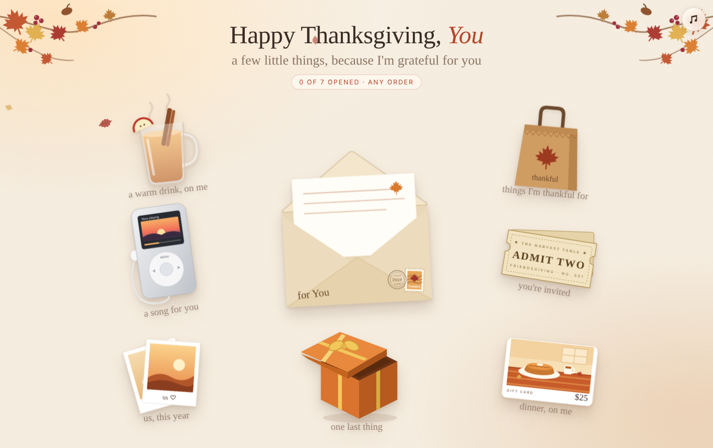

# 🍁 Thanksgiving Thank-You Card

A cozy, interactive thank-you page. It looks like a desk of little gifts: an
**"open me first"** letter, a cup of cider, a music player, a gratitude bag, an
invitation ticket, photos, a "dinner, on me" gift card, and a gift box finale.
Autumn leaves drift down in the background.



**[Live Sample →](https://lindenwang1.github.io/Thanksgiving/)**

## Features
- **Built-in Editor:** open `customize.html` to fill in a form, see the changes live, and download a finished card. No coding needed.
- Envelope addressed to the recipient by name, with a postage stamp and a wax seal that cracks open. The other gifts unlock after the letter is read, and the letter writes itself in line by line.
- Check marks on opened gifts and an "x of 7 opened" counter. The gift box glows when it's the last one left.
- Invite ticket with an **Add to Calendar** button
- **↺ Start Over** button in the finale
- Falling leaves, plus a burst of leaves when the gift box opens
- Music toggle. Plays a built-in original tune, or your own audio file.
- Polaroid photo album: a loose stack you flip through by tapping, swiping, or using the arrow keys
- Gift card with copy-code and redeem buttons
- Four color themes: `harvest`, `cranberry`, `sage`, and the dark `dusk`, each with drifting warm light and a corner garland
- Leaves in three shapes that tumble at different depths, blow sideways in gusts, and drift away from your cursor
- Built-in music that needs no file: a soft music-box melody with a second section, a fireplace crackle, or both
- In the dark `dusk` theme, warm embers drift up from the bottom of the screen
- Every gift can be hidden. Works on phones, keyboard-accessible, and respects reduced motion.
- One HTML file with no build step or dependencies

## Make a Personal Card (Keeps It Private)

Personal cards never need to touch GitHub.

### Option A: Editor (Easiest)

Open `customize.html`, either the copy on your computer or the live site.
Fill in the form, add photos (they're resized automatically), and click **⬇ Download Card**.
Everything runs in your browser and nothing is uploaded. To edit a card later, use **Open Card…**, or open the
downloaded file with `#edit` added to the end of its address.

### Option B: Share Link

Open the editor on your live site and click **🔗 Copy Link**.
The whole card goes into the part of the link after `#`, which browsers never send to the server. So GitHub
stores nothing, and each person gets their own link. Uploaded photos don't fit in a link: use image links
(https://…) or send the downloaded file instead. Anyone with the link can open the card.
To change a link later, open it, add `&edit` to the end of the address, and copy a new link.

### Option C: Script

```bash
mkdir -p private/you/photos
cp people.example.json private/you/you.json   # edit it
# put photos in private/you/photos/
python3 tools/make_card.py private/you/you.json
# → private/you/thanksgiving-you.html  (photos + music embedded)
```

Send that single `.html` file directly by text, email, or AirDrop. It opens in any browser.
`private/` is in `.gitignore`, so it's never committed.

### Privacy Notes
- Anyone who has the file (or a link to it, if you host it) can see everything in it, including gift-card codes.
- If you host a personal card online, use an unguessable URL (e.g. a random Netlify Drop link), not this public repo.
- For music, use a song you have the rights to share, or leave `src` empty to use the built-in tune.

## Config Reference
| Field | What It Does |
|---|---|
| `to`, `from`, `greeting`, `subtitle` | Header text |
| `theme` | `harvest` · `cranberry` · `sage` · `dusk` |
| `leaves` | `normal` · `light` · `lots` · `off` |
| `letter.text` / `signoff` | Main note. Blank lines start new paragraphs. |
| `cider`, `gratitude`, `ticket`, `photos`, `giftcard`, `music`, `finale` | Each gift. Add `"enabled": false` to hide one. |
| `photos.items[]` | `{ "src": "photos/1.jpg", "caption": "…" }` |
| `ticket.date` | `2026-11-28T18:00` adds an "Add to Calendar" button |
| `giftcard` | `brand`, `amount`, `code`, `link` (https), optional `image` |
| `music.mode` | Built-in sound: `both` · `melody` · `fireside` |
| `music.src` | mp3/m4a path or URL. Empty means the built-in sound. |

## Hosting the Public Sample
Settings → Pages → Deploy from branch → `main` / root. Then, in `index.html`, change the `og:image` meta tag to the
full address (`https://lindenwang1.github.io/Thanksgiving/og.png`) so shared links show a preview picture.
